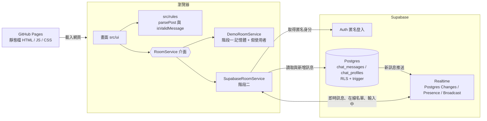

# 匿名聊天室:架構文件

## 1. 專案目標

一個不用登入的匿名聊天室,所有人在同一個聊天室裡。

必備:雙向即時聊天、線上名單與進出提示、純文字顯示(不執行 HTML)、手機版可用。
加分:正在輸入提示、傳送狀態與重試、字數計數器、載入更早的訊息、斷線重連、資料庫端的頻率限制與內容清理。

開發分兩個階段:**階段一先做前端,用假資料的展示模式跑起來;階段二才接 Supabase。** 兩個階段共用同一套畫面。

## 2. 架構圖

三個角色:**瀏覽器**(執行畫面與 RoomService)、**GitHub Pages**(只負責送出靜態檔,不處理任何聊天資料)、**Supabase**(身分、資料、即時推送)。



## 3. 技術選擇與理由

| 項目 | 選擇 | 理由 |
|---|---|---|
| 語言 | 原生 TypeScript | 專案小,不需要框架;型別能把 `RoomService` 介面釘死 |
| 建置 | Vite | 設定少,輸出純靜態檔,可放 GitHub Pages |
| 後端 | Supabase | Postgres + Realtime + 匿名登入一次具備,不用自己架伺服器 |
| 部署 | GitHub Pages(Actions) | 免費、靜態網站即可 |

## 4. 兩階段與 RoomService 介面

畫面只認識 `RoomService`,不知道背後是展示模式還是 Supabase。用環境變數 `VITE_CHAT_MODE` 選擇:`demo`(預設)或 `live`。

```ts
interface RoomService {
  connect(): Promise<Me>                                  // 取得身分與暱稱
  loadRecent(limit: number): Promise<Message[]>
  loadOlder(before: string, limit: number): Promise<Message[]>   // before = created_at
  send(id: string, content: string): Promise<void>        // 失敗時 throw ChatError
  onMessage(cb: (m: Message) => void): void
  onPresence(cb: (members: Member[]) => void): void
  onNotice(cb: (text: string) => void): void              // 進出提示
  setTyping(typing: boolean): void
  onTyping(cb: (names: string[]) => void): void
  onConnection(cb: (state: 'online' | 'reconnecting' | 'lost') => void): void
  leave(): Promise<void>
}
```

- **階段一**:`DemoRoomService` 在記憶體裡運作,有幾個假使用者會進出、輸入、回話。不需要任何金鑰,可以直接部署展示。
- **階段二**:`SupabaseRoomService` 實作同一個介面。畫面程式一行都不用改。

## 5. 訊息格式

```ts
interface Message {
  id: string          // UUID,由前端產生,重送時沿用,避免重複顯示
  authorId: string    // 由伺服器填
  nickname: string    // 由伺服器填
  content: string     // 1 到 500 字,純文字
  createdAt: string   // ISO 時間,由伺服器填
}
```

自己送出的訊息在畫面上多一個本地狀態:`sending`、`sent`、`failed`,不存進資料庫。

## 6. 資料流

1. 進入畫面(可填暱稱)→ `connect(name?)` 取得匿名身分,資料庫的 `chat_join(name)` 清理暱稱並加上固定 3 碼編號 → `loadRecent(50)` → 訂閱 `onMessage`、`onPresence`、`onTyping`。
2. 送出 → `parsePost()` 驗證與清理 → 畫面先以 `sending` 顯示 → `send()` → 成功變 `sent`;失敗變 `failed`,按重試用同一個 id 再送。
3. 收到別人的訊息 → **先用 `isValidMessage()` 檢查格式**(id 是 UUID、暱稱與內容是字串、內容 1 到 500 字、時間可解析),不合格就丟棄 → 以 id 去重 → 用 `textContent` 加入畫面。
4. 輸入框有內容 → `setTyping(true)`,停止 3 秒後或送出後 `setTyping(false)`。
5. 斷線 → `onConnection('reconnecting')` → 畫面顯示「重新連線中…」;超過 60 秒回到進入畫面。
6. 離開 → 按「離開」或斷線太久 → `leave()` 關閉即時連線,線上名單對其他人更新並顯示離開提示;匿名身分保留在瀏覽器,下次進入暱稱不變。

## 7. 畫面清單

1. **進入畫面**:說明、選填的暱稱欄位(最多 12 字)與「進入聊天室」按鈕(斷線太久也回到這裡)。暱稱由資料庫清理後加上 `#` 與 3 碼編號,同一個匿名身分的編號固定;不填則給隨機暱稱。
2. **聊天畫面**:頂部標題與線上人數、訊息清單、輸入區。
   - 訊息氣泡(自己靠右)、進出提示、「正在輸入…」。
   - 自己訊息的狀態:傳送中、已送出、傳送失敗與重試。
   - 輸入區的字數計數器(N / 500)。
   - 清單最上方的「載入更早的訊息」(累積超過 50 則才出現)。
3. **線上名單**:可展開的暱稱清單。
4. **連線橫幅**:「重新連線中…」。

## 8. 金鑰

| 金鑰 | 可以公開嗎 | 放哪裡 |
|---|---|---|
| Supabase 專案網址 | 可以 | 本機 `.env.local`;GitHub 的 Actions Variables |
| publishable key(`sb_publishable_...`) | 可以(設計上就是給瀏覽器用,安全靠 RLS) | 本機 `.env.local`;GitHub 的 Actions Variables |
| secret key(`sb_secret_...`)、`service_role` | **絕對不行** | 前端和 repo 都不使用。若 CI 將來需要,放 GitHub Secrets,不放 Variables |
| 資料庫密碼 | **不行** | 不使用 |

`.env.local` 已列入 `.gitignore`,repo 只有 `.env.example`。

## 9. 安全與限制

- **資料庫把關**:前端檢查只是體貼使用者。發言者、暱稱、時間都由資料庫 trigger 填入;前端只被允許寫入 `id` 與 `content`;沒有人能修改或刪除訊息。
- **RLS**:資料表啟用列級安全,只有已登入(含匿名)的身分能讀、能新增。
- **頻率限制**:每人 10 秒內最多 5 則,兩則至少間隔 0.5 秒,由 `BEFORE INSERT` trigger(`chat_stamp_message`) 強制。
- **內容清理**:伺服器端去除頭尾空白,並限制 1 到 500 字。
- **XSS**:所有使用者內容只用 `textContent` 顯示,不使用 `innerHTML`。
- **已知限制**:
  - **代號可能被冒用**:匿名身分只存在瀏覽器裡,清除資料就換一個新身分;暱稱是自己取的,編號只有 3 碼,仍可能與他人重複,不能當作身分證明。
  - **訊息永久保存**:沒有刪除功能,畫面一次只載入最近 50 則,更早的要手動載入。
  - 匿名登入無法阻止有心人大量建立身分繞過頻率限制。
  - **直接關閉或重新整理分頁時,名單上的自己可能殘留一陣子**:即時連線沒有正常道別時,要等伺服器逾時才會移除。頁面在 `pagehide` 會盡力離開頻道,但不保證來得及送出;按「離開」則會立刻移除。

## 10. 刻意不做

登入與註冊、私訊與多房間、訊息編輯與刪除、圖片與檔案上傳、已讀回條、推播通知、管理員後台與檢舉。

> 資料表名稱加 `chat_` 前綴(`chat_messages`、`chat_profiles`),避免與同一個 Supabase 專案裡的其他專案衝突。`messages` 在本文件中指 `chat_messages`。`profiles` 同理。

## 11. 資料夾結構

```
docs/architecture.md        本文件
src/
  main.ts                   進入點,依模式建立 RoomService
  types.ts                  Message、Member、RoomService 介面
  rules/parsePost.ts        驗證與清理
  service/demo.ts           階段一:展示模式
  service/supabase.ts       階段二:Supabase
  ui/                       畫面
  style.css
supabase/schema.sql         資料表、RLS、trigger
.github/workflows/deploy.yml
```

## 12. 部署

GitHub Actions 建置後發佈到 GitHub Pages。`workflow_dispatch` 可以選擇 `demo` 或 `live` 模式:階段一只需要選 `demo`,不用任何金鑰就能部署展示。`live` 模式從 Actions Variables 讀取專案網址與 publishable key。

## 13. 分階段的驗證清單

**階段一(展示模式,不連資料庫)**
- [ ] 進入聊天室後看得到假使用者的訊息與線上名單
- [ ] 送出訊息立刻顯示,狀態從「傳送中」變「已送出」
- [ ] 假使用者進出時有提示;有人「正在輸入…」
- [ ] 字數計數器正確;超過 500 字不能送出
- [ ] 輸入 `<b>x</b>` 顯示為文字,不是粗體
- [ ] 手機寬度沒有橫向捲軸
- [ ] 累積超過 50 則時出現「載入更早的訊息」

**階段二(接 Supabase)**
- [x] 兩個瀏覽器互傳訊息都收到(約 30 到 60 毫秒)
- [x] 線上名單互相看得到,離開後更新,有進出提示
- [x] 「正在輸入…」互相看得到
- [x] 10 秒內送第 6 則被拒絕,顯示「發言太快了」
- [x] 偽造暱稱的請求被資料庫拒絕(直接呼叫 REST API 帶 `nickname` 或 `author_id`,回 403)
- [x] 斷線時顯示「重新連線中…」,恢復後自動回來並補上漏掉的訊息
- [x] 重新整理後最近 50 則還在,暱稱不變

階段二的項目由 [`e2e/e2e.mjs`](../e2e/e2e.mjs) 對線上版實測(兩到三個獨立瀏覽器、手機寬度 390px),22 項全部通過,結果見 [`e2e_result.json`](e2e_result.json),截圖在 `docs/screenshots/`。階段一(展示模式)與「載入更早的訊息」尚未自動化測試,上面的勾選框保留為人工驗證。
